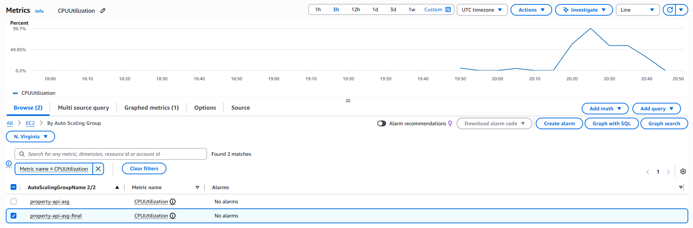
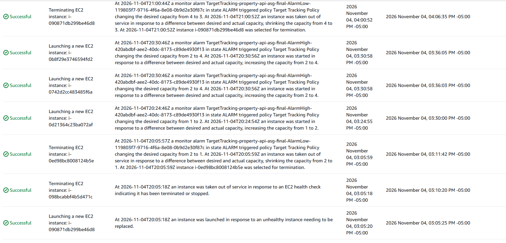

# Week 6 Load Test Report: PropertyLite behind an ALB + Auto Scaling Group

## Setup
- **Architecture:** ALB (`property-alb`) in the public subnets, forwarding HTTP:80 to
  target group `property-api-tg` (port 8080, health check `/health`). Auto Scaling
  group `property-api-asg` runs PropertyLite on `t3.micro` instances in the private
  subnets of `training-vpc`.
- **ASG settings:** desired 2 / min 1 / max 4. Target tracking policy on
  average CPU utilization, target 50%.
- **How I reached the instances:** a bastion host in a public subnet, using SSH agent
  forwarding.
- **Region / date:** us-east-1, 11/4/2026

## Test 1: Self-healing
I terminated one instance manually and watched the ASG replace it.

| Event | Time |
|---|---|
| Instance `i-098bcabbf4b5d471c` terminated | 03:05:18 |
| ASG launched replacement `i-090871db299be46d8` | 03:05:20 |
| Replacement showed healthy in target group | 03:24:55 |

- **Time to launch a replacement:** 2 seconds

## Test 2: CPU load and scale-out
I ran `stress-ng --cpu 2 --timeout 600s` on **both** instances, so the ASG's
average CPU would actually cross the 50% target.

| Event | Time |
|---|---|
| Stress started on instance 1 / instance 2 | 03:16:58 / 03:17:14 |
| Average CPU first crossed 50% (CloudWatch) | 03:18:20 |
| Scaling alarm entered `ALARM` | 03:30:58|
| ASG launched new instance (Activity tab) | 03:30:58 |
| New instance healthy in target group | 03:31:40 |
| Peak average CPU | 99.7% |

**Gap between CPU spike and scale-out:** 2 minutes, 38 seconds

## What I learned
- An ALB needs an explicit security group rule to reach its targets.
- Target tracking scales on the **average** across the group, so uneven load can hide a
  hot instance.
- Self-healing replaces failed instances automatically, while the ALB keeps routing
  to the healthy ones.

## Cleanup
Deleted in order: ASG, ALB, target group, launch template, bastion, NAT gateway
(and released its Elastic IP), then the VPC.
