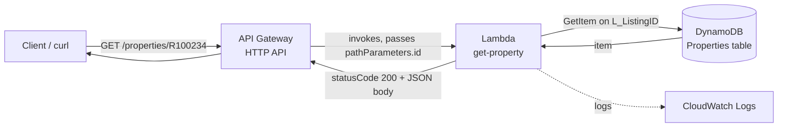

# Week 7: Serverless & Event-Driven Architecture

## What I built
I re-hosted PropertyLite's `GET /properties/<listing_id>` lookup without an
always-on server. The Flask route that read from a CSV is now a Lambda function that
reads from DynamoDB, which is exposed through an API Gateway HTTP API. I also practiced
decoupling with an SQS queue and a dead-letter queue.

## Request path



1. The client sends `GET /properties/R100234` to the API's invoke URL.
2. API Gateway matches the route `GET /properties/{id}` and captures `R100234`
   as the path parameter `id`.
3. API Gateway invokes the `get-property` Lambda function with an event containing
   `pathParameters.id`.
4. The Lambda calls `GetItem` on the `Properties` table using `L_ListingID` as the key.
5. DynamoDB returns the item. The Lambda wraps it as
   `{"statusCode": 200, "body": "<json>"}`, and API Gateway sends that back to the client.

## Security: least-privilege IAM
The Lambda's execution role has two policies:
- `AWSLambdaBasicExecutionRole` (managed): lets it write logs to CloudWatch.
- `PropertiesTableReadOnly` (inline, custom): allows only `dynamodb:GetItem` on
  `arn:aws:dynamodb:us-east-1:<account-id>:table/Properties`.

The function can't read other tables, write to this one, or touch any other service,
because the policy grants only the single action it needs on the one resource. I
used a custom policy instead of `AmazonDynamoDBReadOnlyAccess`, which would
allow reads on every table in the account.

## SQS and the dead-letter queue (Lab 7.2)
`property-queue` has a redrive policy with `maxReceiveCount = 3` pointing to
`property-dlq`. A message that fails processing three times moves to the DLQ
instead of retrying forever, so I can inspect failures without blocking the main queue.
I confirmed the setup by sending a message and receiving it with the CLI.

## Testing

### API Endpoint Test Results

**1. `GET /properties/R100234`**

- **Expected:** 200 + Sacramento listing
- **Actual:**
```json
{
  "L_SystemPrice": "450000",
  "L_ListingID": "R100234",
  "L_Status": "Active",
  "L_Keyword2": "3",
  "LM_Int2_3": "1450",
  "LM_Dec_3": "2.0",
  "L_City": "Sacramento"
}
```

**2. `GET /properties/R100235`**

- **Expected:** 200 + Fresno listing
- **Actual:**
```json
{
  "L_SystemPrice": "395000",
  "L_ListingID": "R100235",
  "L_Status": "Active",
  "L_Keyword2": "4",
  "LM_Dec_3": "2.5",
  "LM_Int2_3": "1900",
  "L_City": "Fresno"
}
```

**3. `GET /properties/DOESNOTEXIST`**

- **Expected:** 200 + `{}`
- **Actual:**
```json
{}
```

**4. `GET /properties`**

- **Expected:** 404 `Not Found`
- **Actual:**
```json
{"message":"Not Found"}
```

Note: the Lambda returns `200` with an empty object for an ID that doesn't exist, where
PropertyLite on EC2 returned `404 {"error": "not found"}`.

## Problems I ran into and how I fixed them
| Problem | Cause | Fix |
|---|---|---|
| `Could not resolve host` | I used the route ID from route details as the hostname | The URL needs the API ID. Copied the full Invoke URL from the API's overview page |
| Response said "Hello from Lambda!" | My code wasn't deployed, so Lambda was still running the default template | Pasted the code and clicked Deploy in the Code tab (not the Lambda@Edge option in Actions) |

## What I learned
- A Lambda only changes after **Deploy**. Edits that are saved but not deployed do nothing.
- The path parameter name in the route (`{id}`) must match what the code reads
  (`event['pathParameters']['id']`).
- CloudWatch Logs is the first place to look for any Lambda error, because the API response
  alone doesn't show the cause.
- DynamoDB numbers come back as Python `Decimal`, which `json.dumps` can't serialize,
  so I stored values as strings.

## Cleanup
Deleted: the API Gateway API, the `get-property` Lambda function (and its log group),
the `Properties` table, and both SQS queues.